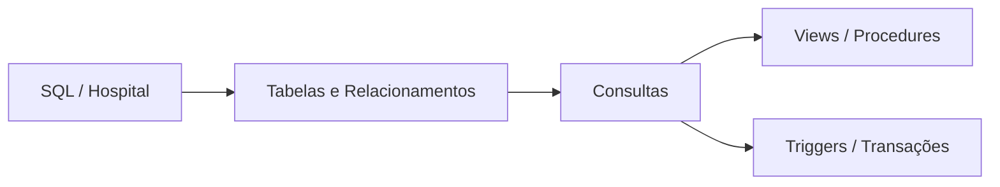

<div align="center">

# B A N C O　D E　D A D O S　I I

### `SQL • MARIADB • PROCEDURES • TRIGGERS`

**Atividade acadêmica com esquema hospitalar, consultas e objetos de banco em MariaDB.**


`FATEC` · `ADS` · `BACKEND / LAB`

[Visão geral](#visao-geral) · [Módulos](#modulos) · [Arquitetura](#arquitetura) · [Execução](#execucao)

</div>

---

<a id="visao-geral"></a>

## `PROJECT // VISÃO GERAL`

Atividade acadêmica com esquema hospitalar, consultas e objetos de banco em MariaDB.

## `SYSTEM // STATUS`

| Componente | Situação no repositório |
| :--- | :---: |
| `hospital_completo.sql`: estrutura e dados do hospital | `● DOCUMENTADO` |
| `resolucao_20_exercicios.sql`: resolução de vinte exercícios | `● DOCUMENTADO` |
| Exercícios envolvendo procedures, views, triggers e transações | `● DOCUMENTADO` |
| Trabalho desenvolvido para Banco de Dados II; material original em `README.txt` | `● DOCUMENTADO` |

<a id="modulos"></a>

## `CORE // CONTEÚDO`

- `hospital_completo.sql`: estrutura e dados do hospital
- `resolucao_20_exercicios.sql`: resolução de vinte exercícios
- Exercícios envolvendo procedures, views, triggers e transações
- Trabalho desenvolvido para Banco de Dados II; material original em `README.txt`

<a id="arquitetura"></a>

## `ARCHITECTURE // FLUXO CONCEITUAL`



<a id="execucao"></a>

## `BOOT SEQUENCE // EXECUÇÃO LOCAL`

```bash
git clone https://github.com/gilbertocorrea-cmd/Banco-de-Dados-II.git
cd Banco-de-Dados-II
```

Use MariaDB e um cliente como DBeaver. Execute o dump `hospital_completo.sql` em ambiente de estudos; consulte e rode `resolucao_20_exercicios.sql` conforme a sequência e os comentários do código. O `README.txt` cita `Hospital.sql`, mas esse arquivo **não está presente** na árvore atual do GitHub: utilize o dump existente e confira as dependências dos scripts.

O arquivo [`README.txt`](README.txt) permanece disponível como registro da entrega original.

---

## `DATABASE // ARQUIVOS`

| Arquivo | Uso |
| :--- | :--- |
| [`hospital_completo.sql`](hospital_completo.sql) | Dump do banco de estudo |
| [`resolucao_20_exercicios.sql`](resolucao_20_exercicios.sql) | Exercícios SQL |
| [`README.txt`](README.txt) | Instruções originais de entrega |

---

<div align="center">

## `BANCO DE DADOS II // BUILD • LEARN • EVOLVE`

**Gilberto Corrêa** · ADS — FATEC

[GitHub](https://github.com/gilbertocorrea-cmd)

</div>
